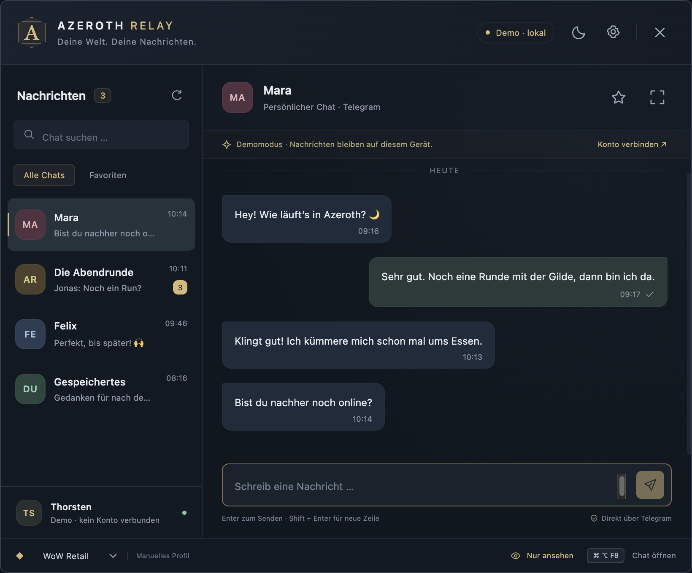

# Azeroth Relay

Telegram-Nachrichten lesen und beantworten, während World of Warcraft Retail oder Forever geöffnet ist. Eine eigenständige Desktop-App für Windows und macOS mit frei platzierbarem Overlay, Hotkeys und getrennten Spielprofilen.

## Installieren

Die Anwendung enthält ihre Laufzeit. Für die Installation wird weder Node.js noch Python benötigt.

**[Downloads und Versionshinweise für 0.1.1](https://github.com/sahnebar/wowtelegram/releases/tag/v0.1.1)**

| System | Installer |
|---|---|
| Windows x64 | [Windows-Installer](https://github.com/sahnebar/wowtelegram/releases/download/v0.1.1/Azeroth-Relay-0.1.1-Windows-x64.exe) |
| Mac mit Apple Silicon | [macOS arm64 · DMG](https://github.com/sahnebar/wowtelegram/releases/download/v0.1.1/Azeroth-Relay-0.1.1-macOS-arm64.dmg) |
| Mac mit Intel-Prozessor | [macOS x64 · DMG](https://github.com/sahnebar/wowtelegram/releases/download/v0.1.1/Azeroth-Relay-0.1.1-macOS-x64.dmg) |

Dies ist eine **unsignierte Testversion**. In Windows den Installer ausführen; auf dem Mac die DMG öffnen und Azeroth Relay in den Programme-Ordner ziehen. Vor einem Update die bisherige App vollständig über ihr Menü beenden. Telegram-Zugangsdaten werden erst lokal in der App eingegeben; sie sind nicht Bestandteil des Downloads.



## Starten

Voraussetzung für die Entwicklung: Node.js 22.16 oder neuer, npm und Windows 11 x64 bzw. macOS 13 oder neuer. Auf dem Mac werden Apple Silicon und Intel als getrennte Builds unterstützt. Die endgültige Freigabe einer Plattform benötigt einen Test auf dem jeweiligen Betriebssystem.

```sh
git clone https://github.com/sahnebar/wowtelegram.git
cd wowtelegram
npm ci
npm start
```

Ohne Telegram-Anmeldung ausprobieren:

```sh
npm run demo
```

Falls npm Installationsskripte nicht automatisch ausführt und Electron seine Laufzeit vermisst:

```sh
node node_modules/electron/install.js
```

## Dein Telegram-Konto verbinden

1. Bei [my.telegram.org/apps](https://my.telegram.org/apps) mit deinem Telegram-Konto anmelden und eine eigene Anwendung anlegen. Benötigt werden `api_id` und `api_hash`, kein Bot-Token.
2. Diese beiden Werte **lokal im Anmeldefenster von Azeroth Relay** eintragen. Nicht in Quellcode, Git, Screenshots oder Chatnachrichten kopieren.
3. QR-Code anzeigen und in der Telegram-App unter **Einstellungen → Geräte → Desktop-Gerät verknüpfen** scannen. Alternativ Telefonnummer mit Ländervorwahl verwenden.
4. Falls Telegram zusätzliche Bestätigungsschritte verlangt, Code, E-Mail-Code oder Zwei-Schritt-Passwort in der App eingeben.

Das Overlay meldet sich als eigenes Telegram-Gerät an. Auf Windows und Mac wird jeweils eine eigene Sitzung verwendet. Telegram-CAPTCHAs oder kostenpflichtige SMS-Anmeldewege werden nicht automatisiert; in diesem Fall die QR-Anmeldung verwenden. Es werden keine neuen Telegram-Konten angelegt.

## Bedienung

| Aktion | macOS | Windows |
|---|---|---|
| Chat öffnen / ausblenden | ⌘ + ⇧ + Leertaste | Strg + Umschalt + Leertaste |
| Ruhemodus umschalten | ⌘ + ⇧ + D | Strg + Umschalt + D |
| Nachricht senden | Enter | Enter |
| Neue Zeile | Shift + Enter | Shift + Enter |
| Antwort abbrechen / Overlay ausblenden | Esc | Esc |

Beide globalen Tastenkürzel sind in den Einstellungen änderbar, beispielsweise `Alt+Shift+T`. Bereits belegte Kürzel werden nicht übernommen. Das Infobereichssymbol bzw. das Menüleistensymbol und das App-Menü öffnen das Fenster ebenfalls.

- **Nur ansehen:** Das Fenster nimmt keine Tastatureingaben und keine Mausklicks mehr an. Zum Weiterschreiben den Hotkey oder das App-/Infobereichsmenü verwenden.
- **Spielen und Schreiben:** Beim Antworten übernimmt das Overlay den Tastaturfokus. Zum Weiterspielen schließen oder ins Spiel klicken. Eine Nachricht aktiviert das Schreibfenster niemals automatisch.
- **Benachrichtigungen:** Kurz eingeblendetes, nicht fokussierbares Fenster. Namen und Text bleiben standardmäßig verborgen. Ruhemodus und Favoritenfilter werden berücksichtigt.
- **Favoriten:** Stern in der Gesprächskopfzeile; links zwischen allen Chats und Favoriten wechseln.
- **Antworten:** An einer Nachricht den Antwortpfeil auswählen. Entwürfe bleiben beim Chatwechsel erhalten.
- **Retail / Forever:** Unten das Spielprofil wählen. Deckkraft, Kompaktansicht und Fensterposition werden getrennt gespeichert. Die Profilauswahl bleibt bewusst manuell; die Spielerkennung blendet bei Bedarf außerhalb von WoW aus.
- **Kompaktansicht:** Chatliste einklappen; über den Zurück-Pfeil wieder einen Chat auswählen.
- **Versandfehler:** Entwurf bleibt erhalten. Chat aktualisieren und den Verlauf prüfen, bevor ausdrücklich erneut gesendet wird. Bei unklarer Bestätigung erfolgt kein automatischer Wiederholungsversand durch die App.
- **Ausblenden / Beenden:** Das Kreuz blendet nur aus. Vollständig beenden über das App-/Infobereichsmenü oder die Einstellungen.

Für erste Spieltests **Fenster oder randloses Fenster** verwenden. Exklusives Windows-Vollbild wird nicht zugesagt. macOS-Vollbild-Spaces sind implementiert, müssen aber mit dem jeweiligen WoW-Client, Monitoraufbau und der macOS-Version praktisch geprüft werden.

## Funktionsumfang

- Persönliche Cloud-Chats, gespeicherte Nachrichten und Gruppen; weitere Chats und ältere Nachrichten nachladen.
- Text, Emojis, Antworten, eingehende Nachrichten, Änderungen und Löschupdates.
- Lesebestätigungen nur für den tatsächlich angezeigten Chat bei aktivem, interaktivem Fenster am Ende des Verlaufs.
- Lokale Entwürfe im Arbeitsspeicher, Suchfeld, Favoriten und kompakte Ansicht.
- Verbindungsstatus, Wiederverbindung durch die Telegram-Bibliothek und verständliche Fehlermeldungen.
- Mehrere Monitore, getrennte Profile und optionale Spielerkennung anhand öffentlicher Prozessmetadaten.
- Optionaler Autostart in der installierten App.

Medien erscheinen als Texthinweis. Dateien, Fotos, Audio, Anrufe, Kanäle, Bots, geheime Chats und mehrere gleichzeitige Konten sind nicht Bestandteil dieser Version. Selbstlöschende Nachrichten erscheinen bis zur Umsetzung einer vollständigen Ablaufbehandlung nur als Platzhalter ohne ihren Inhalt. Vorhandene geheime Chats eines anderen Telegram-Geräts stehen dieser neuen Sitzung nicht zur Verfügung.

## Daten und Architektur

- Electron: native Fenster, globale Hotkeys, macOS-Spaces, Infobereich und Betriebssystemintegration.
- teleproto: gepflegte MTProto-Clientbibliothek; direkte Verbindung zu Telegram, ohne eigenen Relay-Server.
- Lokale HTML/CSS/JavaScript-Oberfläche. Kein fremder Webinhalt, kein Node-Zugriff im Renderer, Kontextisolation, Renderer-Sandbox und eingeschränkte IPC-Schnittstelle.
- `account.enc`: API-Daten und Telegram-Sitzung, vor dem Schreiben mit Electrons asynchronem `safeStorage` verschlüsselt. Auf macOS nutzt dies den Schlüsselbund, auf Windows DPAPI. Falls der Schutz nicht verfügbar ist, wird keine unverschlüsselte Anmeldung gespeichert. Windows-DPAPI bietet keinen Schutz vor anderen Programmen desselben angemeldeten Benutzers.
- `settings.json`: Darstellungsoptionen, Fensterpositionen, Hotkeys und IDs der favorisierten Chats. Keine Nachrichtentexte oder API-Zugangsdaten.
- Nachrichten, Telefonnummern, Bestätigungscodes, Zwei-Schritt-Passwort und Entwürfe werden von der App nicht dauerhaft gespeichert. Der Betriebssystem-Auslagerungsspeicher liegt außerhalb dieser Zusage.
- Telegram-Transportlogs sind deaktiviert. Die App führt keine Inhaltsprotokolle.
- Kein Zugriff auf WoW-Spielstände oder Prozessspeicher, keine DLL-Injektion, kein Mitschneiden von Spieltasten und keine Änderung der WoW-Installation. Die optionale Spielerkennung liest nur Name, Prozess-ID und Programmpfad der aktiven App.

Die Chatauswahl und Favoriten steuern die Anzeige und Benachrichtigung; die angemeldete Telegram-Sitzung hat die üblichen Kontorechte. Das bestehende Sicherheitsmodell von Telegram bleibt erhalten; normale Cloud-Chats werden durch das Overlay nicht zu Ende-zu-Ende-verschlüsselten Chats.

Die Daten liegen im normalen Electron-Benutzerdatenverzeichnis, üblicherweise:

- macOS: `~/Library/Application Support/Azeroth Relay/`
- Windows: `%APPDATA%\Azeroth Relay\`

Der tatsächliche Verzeichnisname in Entwicklungsstarts kann aus dem Paketnamen abgeleitet sein. **Abmelden** beendet die Sitzung bei Telegram und löscht die lokale Anmeldung. **Lokale Anmeldung löschen** funktioniert auch offline; die entfernte Sitzung kann zusätzlich in Telegram unter **Einstellungen → Geräte** widerrufen werden.

## Prüfen und bauen

```sh
npm run check
npm test
npm run test:ui
```

Die Desktop-Tests verwenden ein isoliertes temporäres Datenverzeichnis und ausschließlich Demo-Nachrichten. Sie verbinden sich nicht mit einem echten Telegram-Konto. Screenshots und der Bericht entstehen unter `test-results/`.

```sh
# Auf macOS: App-Verzeichnis für die aktuelle Rechnerarchitektur
npm run pack

# Auf macOS: DMG/ZIP für Apple Silicon und Intel
npm run build:mac

# Auf Windows: NSIS-Installer für x64
npm run build:win
```

Die aktuellen Ergebnisse stehen unter `release/0.1.1/`. Version 0.1.1 korrigiert das Laden der echten Telegram-Chatliste und behält Antwortverweise auch bei kurzen Versandbestätigungen bei. Zusätzlich prüfen Tests den tatsächlichen Bibliothekscode für Anmeldung, Chat-Paginierung, Verlauf, Versand und Lesebestätigung an einer simulierten RPC-Grenze. Sie ersetzen keinen Live-Test mit Telegram.

Für einen unsignierten Windows-Testbuild auf dem Mac:

```sh
npm run build:win -- --config.win.signExecutable=false
```

Signierung und macOS-Notarisierung benötigen eigene Entwicklerzertifikate. Ohne diese sind lokale Builds Entwicklungs-/Testversionen; ein erzeugtes Installationspaket ist kein Nachweis einer Signierung oder eines bestandenen Windows-Spieltests. Zertifikate gehören in den Betriebssystem-Schlüsselspeicher oder in geschützte CI-Secrets.

Unter `.github/workflows/desktop.yml` liegen native Windows-/Mac-Prüfungen und die Erstellung der Installationspakete. Auf `main` erzeugt der Workflow nach erfolgreichen Prüfungen ein GitHub-Prerelease für die Paketversion, sofern dieses noch nicht existiert. Pull Requests veröffentlichen keine Releases. Der Release-Schritt verwendet ausschließlich den kurzlebigen GitHub-Actions-Token; persönliche Tokens oder Telegram-Zugangsdaten sind nicht erforderlich.

Der aktuelle Lauf ist unter [GitHub Actions](https://github.com/sahnebar/wowtelegram/actions) einsehbar. Ein vorhandener Workflow ist für sich allein noch kein bestandener Testlauf.

## Noch praktisch zu prüfen

Die echte Telegram-Anmeldung, das Laden von Chats und Nachrichten sowie der Versand wurden auf einem Mac praktisch bestätigt. Das ist keine allgemeine Freigabe aller Telegram-Konten oder Geräte. Automatisierte Tests verwenden weiterhin ausschließlich synthetische Daten.

Für beide Plattformen müssen Retail und Forever im gewünschten Fenstermodus praktisch geprüft werden, insbesondere Hotkey-Konflikte, Rückkehr des Fokus zum Spiel und Vollbild-/Monitorwechsel. Die native Windows-Desktop-Prüfung läuft zusätzlich in GitHub Actions. Automatisierte Demo-Tests ersetzen keine Spieltests.

## Quellen

- [Telegram-API und App-Zugangsdaten](https://core.telegram.org/api/obtaining_api_id)
- [Telegram-API-Bedingungen](https://core.telegram.org/api/terms)
- [teleproto-Dokumentation](https://docs.teleproto.dev/)
- [Electron BrowserWindow](https://www.electronjs.org/docs/latest/api/browser-window)
- [Electron safeStorage](https://www.electronjs.org/docs/latest/api/safe-storage)

Unabhängiges Projekt. Keine Verbindung zu Blizzard oder Telegram. World of Warcraft und Telegram sind Marken ihrer jeweiligen Inhaber.
